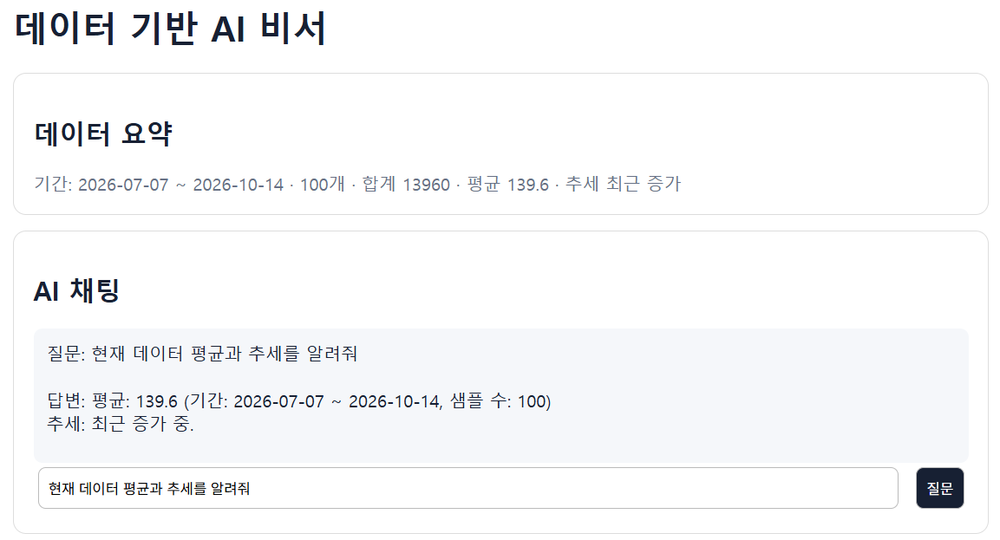
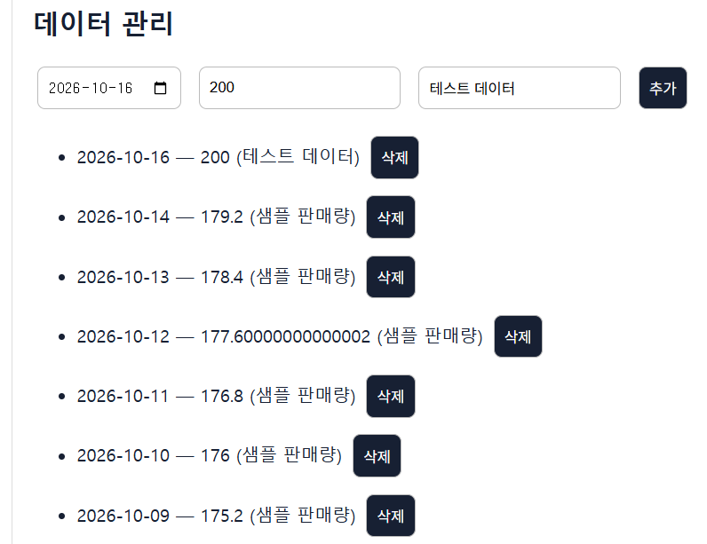
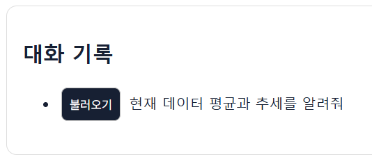
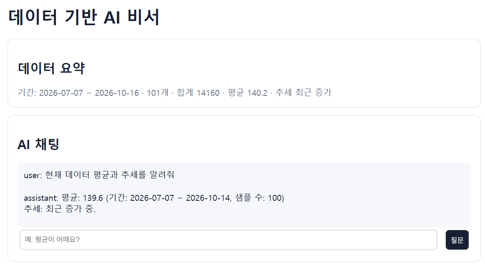

# 데이터 기반 AI 비서

시계열 데이터를 저장하고 요약한 뒤, 그 내용을 바탕으로 답변하는 최소 구현입니다.

## 기술 스택

FastAPI, Firestore, OpenAI API, HTML/CSS/JavaScript

## 실행

```powershell
python -m venv .venv
.\.venv\Scripts\Activate.ps1
pip install -r requirements.txt
Copy-Item .env.example .env
uvicorn main:app --reload
```

브라우저에서 `index.html`을 열고, API 문서는 `http://localhost:8000/docs`에서 확인합니다. 프론트가 다른 포트에서 실행되면 `ALLOWED_ORIGINS`에 해당 주소를 추가하세요.

## 환경 변수

`OPENAI_API_KEY`, `OPENAI_BASE_URL`, `OPENAI_MODEL`, `FIREBASE_SERVICE_ACCOUNT_JSON`, `API_BASE_URL`, `ALLOWED_ORIGINS`를 사용합니다. Firebase/OpenAI 키가 없으면 로컬 메모리 저장과 기본 답변으로 화면을 확인할 수 있습니다. 실제 배포에서는 반드시 키를 Render 환경변수로 등록하세요.

## 배포

백엔드는 Render에서, 프론트는 Vercel에서 배포합니다. Vercel 프로젝트의 Environment Variables에 `API_BASE_URL=https://data-ai-assistant-api-3mcf.onrender.com`을 등록하면 빌드 시 프론트에 API 주소가 주입됩니다. 로컬에서는 기본값 또는 `window.API_BASE_URL`·`localStorage` 설정을 사용할 수 있습니다.

- 프론트 배포 URL: https://3-2-gray-sigma.vercel.app
- 백엔드 API URL: https://data-ai-assistant-api-3mcf.onrender.com
- Swagger URL: https://data-ai-assistant-api-3mcf.onrender.com/docs

## 제출 전 체크리스트

- [ ] Firebase Firestore 활성화 및 서비스 계정 JSON을 Render 환경변수에 등록
- [ ] OpenAI API 키를 Render 환경변수에 등록
- [ ] `python seed_data.py`로 100개 이상 데이터 생성
- [ ] `/docs`에서 API 확인
- [ ] 요약+채팅, 데이터 추가/삭제, 대화 불러오기 화면 스크린샷 첨부

## 제출 스크린샷

제출물에는 다음 화면을 캡처해 첨부합니다.

1. 데이터 요약과 질문·AI 답변이 함께 보이는 채팅 화면



2. 데이터 추가 또는 삭제 결과가 보이는 데이터 관리 화면



3. 대화 목록에서 `불러오기`를 눌러 이전 메시지가 표시된 화면




주요 API: `POST/GET/PUT/DELETE /api/data`, `GET /api/data/summary`, `POST/GET/DELETE /api/conversations`, `GET /api/conversations/{id}`, `POST /api/chat`.
